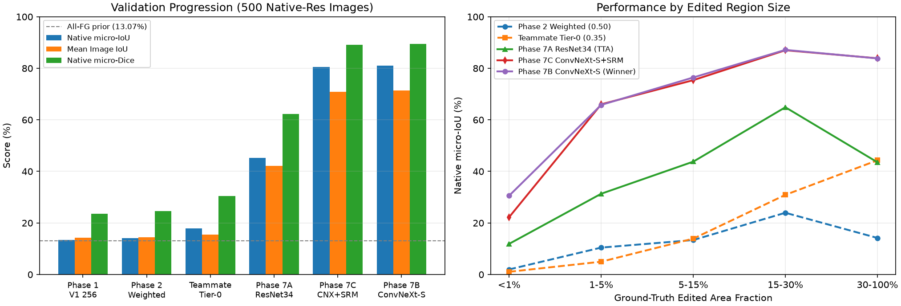

# CS5489 Image Manipulation Localization

从 RGB 图像定位 AI 编辑像素，输出原图尺寸的 0/1 掩码。TA 推理 Notebook 将掩码编码为 RLE 并导出两列 CSV（ID,Predicted）。我们从课程训练数据中固定划出 4,500 张训练图和 500 张验证图。

## 实验进度

当前最终冻结候选为 **Phase 7B：`ConvNeXt-Small Detail-UNet`，512×512，Epoch 25，水平翻转 TTA，阈值 0.50**（纯 PyTorch + torchvision，离线推理显存峰值仅 ~428 MB）。以下为固定 500 张验证图上的原图 `micro-IoU`，全前景盲猜参照为 13.07%。

| 阶段 | 模型或对照 | 原图 micro-IoU | 逐图平均 IoU | micro-Dice |
| --- | --- | ---: | ---: | ---: |
| 1 | [V1 SmallUNet 256](experiments/baseline/README.md) | 13.36% | 14.30% | 23.58% |
| 2 | [Weighted BCE 256](experiments/phase2/Phase2_诊断与实验报告.md) | 14.05% | 14.39% | 24.64% |
| 3 | [V1 384×384](experiments/phase3/Phase3_分辨率实验报告.md) | 13.20% | 14.91% | 23.33% |
| 4 | [RGB + SRM SmallUNet](experiments/phase4/Phase4_SRM实验报告.md) | 11.35% | 12.60% | 20.39% |
| 5 | [Uniform / Mask-aware Crop](experiments/phase5/Phase5_裁块采样实验报告.md) | 9.79% / 10.51% | 9.99% / 11.75% | 17.84% / 19.01% |
| 6 | [三尺度 U-Net 256](experiments/phase6/Phase6_提交冻结与整图对照报告.md) | 11.45% | 12.97% | 20.55% |
| 7A | [ResNet34-UNet 512 (TTA@0.50)](experiments/phase7/Phase7_预训练多尺度分割实验报告.md) | 45.23% | 42.09% | 62.29% |
| 7C | [ConvNeXt-Small + SRM Detail-UNet 512 (TTA@0.50)](experiments/phase7/Phase7_预训练多尺度分割实验报告.md) | 80.51% | 70.92% | 89.20% |
| **7B** | **[ConvNeXt-Small Detail-UNet 512 (TTA@0.50)](experiments/phase7/Phase7_预训练多尺度分割实验报告.md)** | **81.01%** | **71.37%** | **89.51%** |

### Phase 7 核心结果与可视化

- **精度与校准双突破**：在固定 500 张原图验证集上，Phase 7B（`ConvNeXt-Small Detail-UNet`）达到 **`81.01%` micro-IoU**、**`89.51%` micro-Dice**、**`94.66%` Precision**、**`84.89%` Recall**、**`97.40%` 像素准确率** 与 **`94.60%` PR-AUC**；中位逐图 IoU 为 **`87.32%`**（`316/500` 张图 IoU ≥ 0.80），`<1%` 极小编辑组从 `1.98%` 跃升至 **`30.58%`**。
- **关键架构与消融结论**：在 `ConvNeXt-Small`（7×7 深度可分离卷积 + LayerNorm）基础上引入 **stride-1 / stride-2 并行高分辨率空间细节分支**，补足了 stride-4 patchify 丢失的边缘细节；同口径消融（Exp 7B vs 7C）表明 512 缩放输入下固定 SRM 高通滤波反而略降 0.50 pp；5 折折外校准（OOF CV）确认标准阈值 `0.50` + 水平翻转 TTA 稳健无过拟合。
- **TA 离线推理与硬件兼容**：纯 `torch + torchvision` 实现（无需 `scipy` / `timm` / `smp`），推理以 `pretrained=False` 离线加载 `model.pth`（204.8 MB），峰值显存仅 **`428 MB`**（适配 8 GB RTX A1000 及 CPU），已完成 500 张官方公测图端到端 RLE 校验。详阅 [Phase 7 目录](experiments/phase7/README.md) 与 [Phase 7 实验报告](experiments/phase7/Phase7_预训练多尺度分割实验报告.md)。

## 目录

- [experiments](experiments/) 保存 Phase 1–7 的代码、固定划分、配置、实验结果与报告。
- [最终提交候选（Phase 7B）](experiments/phase7/submission_candidate/) 包含带完整执行输出的报告 Notebook、TA 推理 Notebook、模型定义（`models.py`）、复训入口与环境说明（历史 Phase 6 基线候选保留于 [phase6/submission_candidate](experiments/phase6/submission_candidate/)）。
- [environment](environment/) 保存实测依赖和 TA 环境建议。[docs](docs/) 收录复现、协作和交付说明。

## 建立环境

实测环境为 Windows、Python 3.11.16、PyTorch 2.9.1+cu128、torchvision 0.24.1+cu128 和 RTX 5090（推理兼容 TA 8 GB RTX A1000 及 CPU）。

~~~bash
conda create -n cs5489-project python=3.11 pip
conda activate cs5489-project
python -m pip install torch==2.9.1 torchvision==0.24.1 --index-url https://download.pytorch.org/whl/cu128
python -m pip install -r environment/requirements.txt
python -m ipykernel install --user --name cs5489-project --display-name "Python (cs5489-project)"
~~~

CPU 推理可安装 PyTorch + torchvision 的 CPU 版本。 [PyTorch 安装指引](https://pytorch.org/get-started/previous-versions/#v291)

## 运行与复现

- **查看报告与结果**。打开 [project_report.ipynb](experiments/phase7/submission_candidate/project_report.ipynb)，已保留全部执行输出与 Phase 1–7 对比图表，重训入口（`RETRAIN = False`）可按需开启。
- **运行 TA 推理**。将课程图片目录与冻结的 Phase 7B `model.pth` 放在同目录或修改路径，运行 [test.ipynb](experiments/phase7/submission_candidate/test.ipynb)（保留随附的 `models.py`，无需联网）。 [权重 SHA-256](docs/provenance/local_artifact_SHA256SUMS.txt)
- **重训或复算**。历史 Phase 1–6 计数可用 `python tools/recompute_metrics.py` 复算；Phase 7 完整重训与评测入口见 [各阶段运行入口](docs/reproduction.md)。

## 协作与交付

组员从 main 建分支并通过 PR 合并。Canvas 截止前需补齐带运行输出的正式报告，核对小组信息，并配齐推理 Notebook、权重、依赖和环境说明。 [协作命令](docs/collaboration.md) · [课程要求与剩余工作](docs/final_delivery.md)
