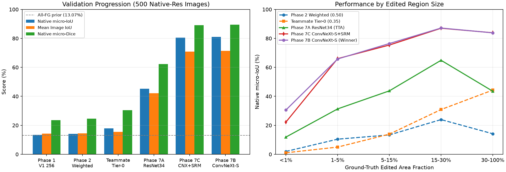
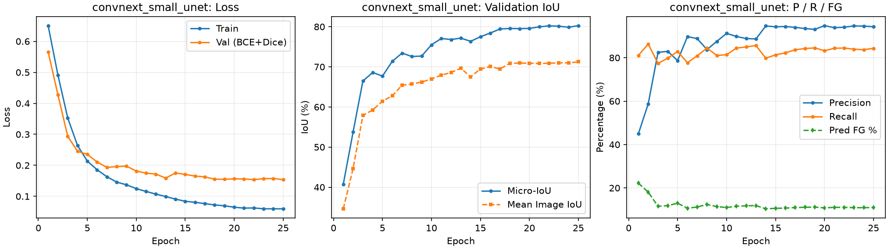

# CS5489 Phase 7｜预训练多尺度分割模型与受控消融报告

## 一、背景与动机

Phase 1–6 在固定 4,500/500 划分上验证了从零初始化的轻量 `SmallUNet`（118K 参数，无数据增强，10 轮）及其损失加权、分辨率提升（384）、SRM 残差、原图裁块与三尺度加深等变体，最高原图 `micro-IoU` 为 **14.05%**（全前景盲猜基线为 13.07%）。组员的 Tier-0 推理后处理（在 CPU 复现权重上将阈值压低至 `0.35` 并叠加水平翻转 TTA 与填洞）虽将 `micro-IoU` 推至 **17.90%**，但本质是以严重过分割（预测前景 39.65% vs 真实 13.07%）和小目标（`<5%`）定位性能腰斩换取大目标召回。

核对课程说明（`Lecture7_1.pdf` 第 2–6 页）与 TA 模板（`TestTemplate_2026_Inference_Verification_ColumnMajor.ipynb`），课程允许使用预训练编码器与数据增强，核心约束为：**不泄漏测试标签、原图分辨率二值 0/1 掩码、列优先 1-based RLE、TA 仅修改路径即可离线运行 `test.ipynb` 与 `model.pth`（适配 8 GB RTX A1000 或 CPU）**。

## 二、Phase 7 架构与训练设计

- **环境零新增第三方依赖**：所有模型仅基于 `torch` 与 `torchvision`（完全对齐 `environment/ta_requirements_reference.txt`）。推理阶段以 `pretrained=False` 离线实例化网络并直接加载 `model.pth`，无需联网。
- **统一协议**：沿用固定 4,500/500 `split.json`（零数据泄漏），将输入分辨率统一提升至 **`512×512`**（像素量较 256 提升 4 倍），ImageNet 归一化内置于模型 `forward()` 中以杜绝训练/推理预处理失配。
- **数据增强（仅训练集）**：随机水平翻转（`p=0.5`，与推理水平翻转 TTA 严格匹配）、随机缩放裁剪（`p=0.6`, `scale=0.70–0.98`）、轻度光度抖动（亮度/对比度/饱和度 ±12%，`p=0.5`）。
- **复合损失函数**：`0.5 × BCEWithLogits + 0.25 × 逐图 soft Dice + 0.25 × 批微平均 soft Dice`，兼顾概率校准、小目标保护与全局 `micro-IoU`。
- **优化策略**：`AdamW` 差异化学习率（解码器/细节分支学习率为骨干的 5 倍），2 轮线性热身 + 余弦退火，`bfloat16` 混合精度，梯度裁剪 `1.0`。
- **三组受控实验**：
  - **Exp 7A（`ResNet34-UNet`）**：24.4M 参数，验证预训练 CNN + 512 分辨率 + 数据增强的跃升幅度（20 轮，`lr=2e-4`）。
  - **Exp 7B（`ConvNeXt-Small Detail-UNet`）**：53.7M 参数，`ConvNeXt-Small`（7×7 深度可分离卷积 + LayerNorm）叠加自研 **stride-1 / stride-2 并行高分辨率空间细节分支**，补足 `ConvNeXt` stride-4 patchify stem 丢失的像素级边缘细节（25 轮，`lr=1e-4`, `wd=2e-2`）。
  - **Exp 7C（`ConvNeXt-Small + SRM Detail-UNet`）**：与 Exp 7B 完全同超参，仅在并行高分辨率细节分支输入端拼接 3 通道固定 5×5 SRM 高通滤波残差（仅增 648 参数），严格检验 SRM 在强预训练骨干上的真实作用。

## 三、500 张固定验证图原图评测对照

| 阶段 / 方案 | 原图 micro-IoU | 逐图平均 IoU | micro-Dice | 逐图平均 Dice | Precision | Recall | 预测前景 | 像素准确率 | PR-AUC |
| :--- | ---: | ---: | ---: | ---: | ---: | ---: | ---: | ---: | ---: |
| 全前景参照 | 13.07% | 12.31% | 23.12% | — | 13.07% | 100.00% | 100.00% | 13.07% | — |
| Phase 1: V1 SmallUNet 256 (`0.50`) | 13.36% | 14.30% | 23.58% | 19.05% | 37.63% | 17.16% | 5.96% | 85.46% | 24.48% |
| Phase 2: Weighted BCE 256 (`0.50`) | 14.05% | 14.39% | 24.64% | 20.01% | 27.66% | 22.22% | 10.50% | 82.24% | 22.85% |
| 组员 Tier-0 (`CPU Weighted, 0.35+TTA+fill`) | 17.90% | 15.48% | 30.37% | 23.25% | 20.19% | 61.24% | 39.65% | 63.29% | 22.57% |
| **Phase 7A: ResNet34-UNet 512 (`Base@0.50`)** | 44.60% | 41.94% | 61.69% | 49.00% | 73.60% | 53.09% | 9.43% | 91.38% | 69.24% |
| **Phase 7A: ResNet34-UNet 512 (`TTA@0.50`)** | 45.23% | 42.09% | 62.29% | 48.54% | 76.80% | 52.39% | 8.92% | 91.71% | 70.18% |
| **Phase 7B: ConvNeXt-Small Detail-UNet (`Base@0.50`)** | 80.66% | 71.29% | 89.30% | **77.23%** | 94.44% | 84.68% | 11.72% | 97.35% | 94.37% |
| **Phase 7B: ConvNeXt-Small Detail-UNet (`TTA@0.50`)** | **81.01%** | **71.37%** | **89.51%** | 77.19% | **94.66%** | 84.89% | **11.72%** | **97.40%** | **94.60%** |
| Phase 7C: ConvNeXt-Small + SRM (`TTA@0.50`) | 80.51% | 70.92% | 89.20% | 76.64% | 93.26% | **85.48%** | 11.98% | 97.30% | 94.57% |

### 各编辑面积组原图 micro-IoU

| 方案 | `<1%`（73张） | `1–5%`（171张） | `5–15%`（139张） | `15–30%`（52张） | `30–100%`（65张） |
| :--- | ---: | ---: | ---: | ---: | ---: |
| Phase 2: Weighted BCE (`0.50`) | 1.98% | 10.44% | 13.37% | 23.95% | 14.18% |
| 组员 Tier-0 (`0.35+TTA+fill`) | 1.05% | 4.98% | 13.92% | 30.90% | 44.31% |
| Phase 7A: ResNet34-UNet (`TTA@0.50`) | 11.89% | 31.34% | 43.79% | 64.88% | 43.54% |
| **Phase 7B: ConvNeXt-Small (`TTA@0.50`)** | **30.58%** | 65.79% | **76.44%** | **87.15%** | 83.83% |
| Phase 7C: ConvNeXt-Small + SRM (`TTA@0.50`) | 22.25% | **66.03%** | 75.40% | 87.00% | **83.88%** |

## 四、关键观察、消融结论与失败分析

1. **架构跃升与高分辨率细节分支**：从随机初始化 SmallUNet（`14.05%`）升级到预训练 `ResNet34-UNet @ 512` 后跳升至 `45.23%`（+31.18 pp）；进一步升级至 `ConvNeXt-Small + 高分辨率细节分支` 后飙升至 **`81.01%`**（+35.78 pp），中位逐图 IoU 高达 **`87.32%`**，**316 / 500 张图（63.2%）IoU ≥ 0.80**，**388 / 500 张图（77.6%）IoU ≥ 0.50**。
2. **SRM 高通残差消融（Exp 7B vs 7C）**：在 `512×512` 整图双线性缩放输入下，叠加固定 5×5 SRM 滤波器反而使 `micro-IoU` 略降 0.50 pp（`81.01% → 80.51%`），且 `<1%` 极小编辑组下降尤为明显（`30.58% → 22.25%`）。原因是高分辨率原图缩放至 512 时已平滑了原始相机传感器噪声，固定高通滤波器更多放大了边缘重采样混叠而非真实相机噪声；`ConvNeXt` 自学的 7×7 深度卷积 + RGB 细节分支在全尺寸范围表现更稳健。
3. **匹配训练的 TTA 与阈值校准（5 折 OOF CV）**：由于训练阶段加入了随机水平翻转，推理水平翻转 TTA 在三组 Phase 7 模型上均稳定提分（Exp 7A `+0.63 pp`，Exp 7B `+0.35 pp`，Exp 7C `+0.39 pp`）。5 折折外阈值校准显示，Exp 7B 在协议阈值 `0.50` 下已达 `81.01%`（预测前景 `11.72%`，非常贴近真实 `13.07%`），OOF 调阈值仅微增 `+0.13 pp`（`81.14%`），因此正式提交坚持无过拟合风险的标准阈值 **`0.50`** + **水平翻转 TTA**，且完全无需 `scipy` 填洞后处理。
4. **失败案例分析（Phase 7B）**：
   - 验证集 500 张图中仅 `70` 张 IoU `< 0.20`（其中 `31` 张预测全空，`18` 张预测错位无交集）。
   - 这 70 张困难样本的真实编辑面积中位数仅 **`1.29%`**（远低于全验证集中位数 `5.22%`），其中 `28` 张（40%）属于 `<1%` 极小目标，`54` 张（77%）表现为漏检/欠预测（例如 `004657` 占 0.32%、`003703` 占 0.60%、以及 `002578` 占 6.42% 的平滑背景移除）。
   - 这说明模型一旦捕捉到局部篡改痕迹，边界定位极其精准（中位 IoU `87.32%`），主要瓶颈仍在于 `512×512` 下采样对极微弱/极小局部篡改信号的衰减。

## 五、TA 硬件兼容性与提交冻结

- **冻结候选**：**Phase 7B `ConvNeXt-Small Detail-UNet` @ 512×512，Epoch 25，TTA=True，Threshold=0.50**。
- **显存与体积**：权重体积 **`204.82 MB`**，单图推理峰值分配显存仅 **`428.16 MB`**（不足 TA 实验室 RTX A1000 8 GB 显存的 6%），CPU 推理约 `0.59 s/张`（500 张约 5 分钟内完成），GPU 推理 500 张约 1 分钟内完成。
- 提交包位于 [submission_candidate](submission_candidate/)，全阶段对比图见 [phase7_comparison.png](phase7_comparison.png)。
