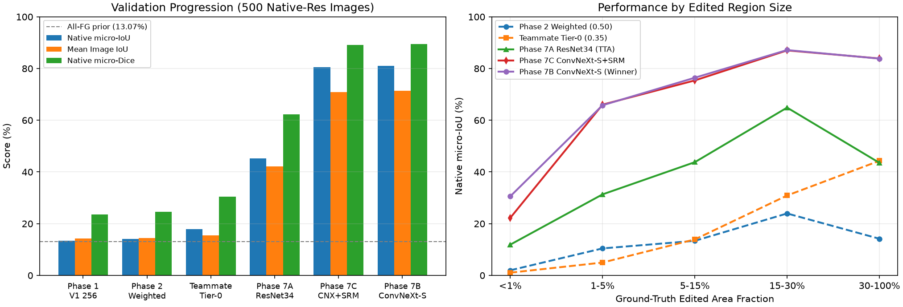

# Phase 7｜预训练多尺度分割与高分辨率细节融合

本目录保存 Phase 7 的全部模型定义、受控消融实验记录、原图分辨率评测、失败案例诊断及最终冻结提交包。所有实验沿用固定 `4,500 / 500` 数据划分（`../baseline/split.json`），零测试标签泄漏，且推理仅依赖 `torch + torchvision`（完全兼容 TA 离线环境与 8 GB RTX A1000）。

## 核心结果对比（500 张原图验证集）

| 实验 | 架构与设置 | 参数量 | 原图 micro-IoU | 逐图平均 IoU | micro-Dice | Precision | Recall | PR-AUC | `<1%` IoU |
| :--- | :--- | ---: | ---: | ---: | ---: | ---: | ---: | ---: | ---: |
| 历史最优 (Phase 2) | SmallUNet Weighted BCE 256 (`0.50`) | 118K | 14.05% | 14.39% | 24.64% | 27.66% | 22.22% | 22.85% | 1.98% |
| 组员 Tier-0 | CPU Weighted 256 (`0.35 + TTA + fill`) | 118K | 17.90% | 15.48% | 30.37% | 20.19% | 61.24% | 22.57% | 1.05% |
| **Exp 7A** | [ResNet34-UNet 512](resnet34_512/training_curves.png) (`TTA@0.50`) | 24.4M | 45.23% | 42.09% | 62.29% | 76.80% | 52.39% | 70.18% | 11.89% |
| **Exp 7C** | [ConvNeXt-Small + SRM 512](convnext_small_srm_512/training_curves.png) (`TTA@0.50`) | 53.7M | 80.51% | 70.92% | 89.20% | 93.26% | **85.48%** | 94.57% | 22.25% |
| **Exp 7B（冻结）** | **[ConvNeXt-Small Detail-UNet 512](convnext_small_512/training_curves.png) (`TTA@0.50`)** | 53.7M | **81.01%** | **71.37%** | **89.51%** | **94.66%** | 84.89% | **94.60%** | **30.58%** |

## 目录导览

- [Phase7_预训练多尺度分割实验报告.md](Phase7_预训练多尺度分割实验报告.md)：完整中文技术报告、消融分析与失败案例诊断。
- [submission_candidate/](submission_candidate/)：可直接独立部署的最终提交候选目录，包含：
  - [project_report.ipynb](submission_candidate/project_report.ipynb)（已完整执行并内嵌表格与图表输出）
  - [test.ipynb](submission_candidate/test.ipynb)（TA 离线推理模板，已通过 500 张公测图端到端验证）
  - [models.py](submission_candidate/models.py)（自包含网络结构、`decode_rle` 与推理函数）
  - [python_environment.txt](submission_candidate/python_environment.txt)（TA 环境依赖说明）
- 核心脚本：[models.py](models.py)、[prepare_cache.py](prepare_cache.py)、[train_phase7.py](train_phase7.py)、[evaluate_phase7.py](evaluate_phase7.py)、[generate_analysis.py](generate_analysis.py)、[build_submission.py](build_submission.py)。
- 三组受控实验档案：[resnet34_512/](resnet34_512/)、[convnext_small_512/](convnext_small_512/)、[convnext_small_srm_512/](convnext_small_srm_512/)。
